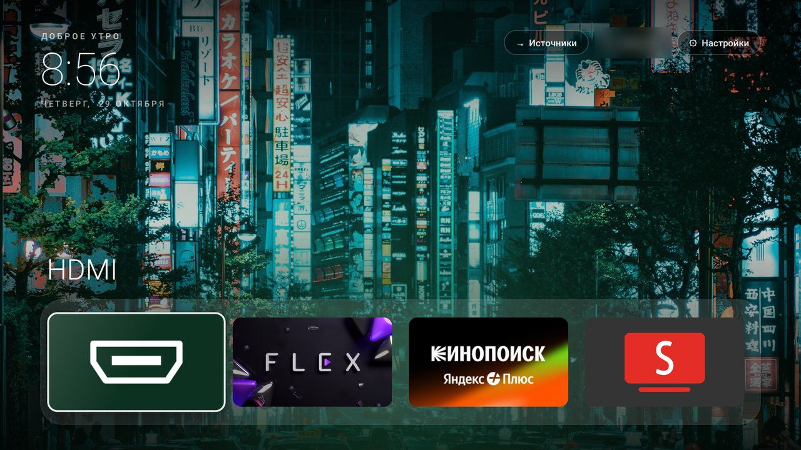

# yandex-tv-tweaks

**Быстрый и чистый Яндекс ТВ без рекламы**: отключаем мусор и телеметрию, ставим минималистичный домашний экран в стиле Apple TV, YouTube без рекламы, аркадную заставку и свои обои. Всё делается с компьютера на Windows по Wi-Fi, одним кликом на каждый шаг. **Всё обратимо**, ничего не удаляется — `restore.bat` возвращает телевизор как было.

## Для кого

Для владельцев телевизоров на **Яндекс ТВ (YaOS)**, у которых телевизор тормозит, главный экран забит рекламой, а YouTube нет. Программировать не нужно: всё запускается двойным кликом по `.bat`-файлам на компьютере с Windows, а каждый шаг можно откатить.

## Вдохновение

Проект вдохновлён [mihirgupta0900/tv-home](https://github.com/mihirgupta0900/tv-home) от **Mihir Gupta** — он сделал то же самое для Google TV на macOS. Отсюда взяты идея и лаунчер. Здесь всё переделано под **Яндекс ТВ** и **Windows**: свой список отключения, обход урезанного меню разработчика через сервисное меню CVTE, плитка HDMI, русский интерфейс, аркадная заставка, SmartTube и VPN-помощники.

## Что получится

- **Меньше тормозов.** Отключаются телеметрия, рекламный идентификатор, заводские утилиты и (по желанию) Алиса, браузер, автообновления. Сам домашний экран Яндекса с рекламой (~350 МБ памяти вместе с его аналитикой) заменяется лёгким своим.
- **Домашний экран** с часами, доком любимых приложений, плиткой **HDMI** (сразу включает приставку), сеткой всех приложений и сменяющимися обоями. Всё на русском.
- **Заставка «Ретро-аркада»** — неоновая сетка, закатное солнце, глитчующие часы, `PRESS ANY BUTTON`. Палитра меняется каждые 45 секунд, часы плавают, чтобы не было выгорания.
- **YouTube** через [SmartTube](https://github.com/yuliskov/SmartTube) — без рекламы.
- **По желанию — VPN** через [v2rayNG](https://github.com/2dust/v2rayNG) со своей подпиской: импорт без ввода текста пультом и автозапуск при включении ТВ.

## Проверено

| Телевизор | Система | Результат |
|---|---|---|
| Hartens HTY-50U11S-VD | Яндекс ТВ, Android 11, MediaTek | всё работает |

Должно подойти и для других телевизоров на Яндекс ТВ, но проверено пока только на одном. Если попробовал на своём — напиши в Issues модель и что получилось.

**Не подходит** для Samsung (Tizen), LG (webOS), Салют ТВ и чистого Google TV (для него — оригинальный [tv-home](https://github.com/mihirgupta0900/tv-home)).

## Что нужно

- Компьютер на Windows 10/11 в той же Wi-Fi сети, что и телевизор.
- Около 600 МБ места: скрипты сами скачают adb, JDK 17 и Android SDK в папку `tools\` (один раз).

## Подготовка телевизора

1. **Настройки → Об устройстве** → 7 раз нажми на **«Версия ОС»** (или «Сборка»), пока не появится «Вы стали разработчиком».
2. Появится раздел **«Для разработчиков»** → включи **«Отладка по USB»** (и «Отладка по сети», если есть такой пункт).
3. При первом подключении телевизор спросит **«Разрешить отладку?»** — отметь «Всегда» и нажми «Разрешить».

### Если пункта «Отладка по USB» нет (часто на Hartens)

На некоторых прошивках тумблер отладки вырезан из настроек, а порт ADB `5555` закрыт. Hartens собираются на платах CVTE, и ADB включается через **сервисное меню CVTE**:

1. Зажми на пульте кнопку **Menu** (три полоски) примерно на секунду.
2. Сразу, без пауз, нажми стрелки: **Влево → Вверх → Влево → Вверх**.
3. Нажми **Назад**.

Поверх интерфейса откроется сине-серое сервисное меню на английском. Пролистай вниз до строки **ADB** (или **USB Debugging**) и переключи в **ON**. После этого телевизор начинает принимать подключения по сети, и можно запускать `1-inspect.bat`.

> ⚠️ **В сервисном меню больше ничего не трогай** — особенно Panel Type, LVDS, White Balance, Backlight и Shipping Init. Неверный пункт там может испортить картинку, сбить калибровку матрицы или превратить телевизор в кирпич.
>
> Комбинация проверена на Hartens HTY-50U11S-VD; на других моделях CVTE она может отличаться. Способ подсказан пользователем сообщества — спасибо!
>
> Если включал ADB так, на шаге `2-debloat.bat` на вопрос про заводское сервисное меню отвечай **n**: без него ADB потом не включить обратно.

## Шаги

Скачай проект (зелёная кнопка **Code → Download ZIP**), распакуй и запускай `.bat` двойным кликом. Телевизор должен быть включён.

| Файл | Что делает |
|---|---|
| `1-inspect.bat` | Только смотрит: модель, система, все приложения, память. Делает бэкап. **Ничего не меняет.** |
| `2-debloat.bat` | Отключает мусор по списку `config\debloat-list.txt`. Про спорное (Алиса, браузер, обновления) — спрашивает. |
| `3-launcher.bat` | Собирает и ставит новый домашний экран с заставкой, отключает экран Яндекса, проверяет кнопку Home. Первый раз — 5–15 минут (качает инструменты сборки). |
| `4-youtube-smarttube.bat` | Ставит SmartTube. |
| `5-screensaver.bat` | Включает заставку «Ретро-аркада». |
| `6-my-wallpapers.bat` | Свои обои: положи картинки в `my-wallpapers\`, скрипт подгонит их под экран и пересоберёт лаунчер. |
| `restore.bat` | **Вернуть всё как было.** |
| `screenshot.bat` | Снимок экрана ТВ в `data\screenshots` — удобно, когда что-то пошло не так. |

### Док и приложения

Порядок плиток — в `launcher\res\values\config.xml` (`dock_apps`). По умолчанию: HDMI, Кинопоиск, SmartTube, Rutube, VK Видео; неустановленные пропускаются. Имена пакетов своих приложений — в отчёте `1-inspect.bat`. Поменял — запусти `3-launcher.bat`.

### VPN (по желанию)

Если YouTube пишет `Unable to resolve host www.youtube.com`, значит в твоей сети он недоступен. Нужен свой VPN-сервис с подпиской или ссылкой для v2rayNG (`vless://`, `vmess://` и т.п.).

| Файл | Что делает |
|---|---|
| `vpn-1-install.bat` | Ставит v2rayNG (проверяет контрольную сумму). |
| `vpn-2-import.bat` | Откроет `vpn-subscription.txt` — вставь туда ссылку, сохрани, запусти снова. Подписка уйдёт в v2rayNG без ввода текста пультом. |
| `vpn-3-connect.bat` | Нажимает «выбрать сервер» и «подключить» за тебя (интерфейс v2rayNG рассчитан на сенсорный экран). |
| `vpn-4-autostart-on.bat` | VPN сам поднимается при включении ТВ. Выключить — `vpn-autostart-off.bat`. |

Если через VPN перестали работать Кинопоиск или Rutube — выключи автозапуск.

## Безопасность и откат

- Пакеты **отключаются** (`pm disable-user`), а не удаляются. `restore.bat` включает всё обратно, возвращает экран и заставку Яндекса и выключает автозапуск VPN.
- В список отключения не входят системные сервисы, без которых ТВ сломается (настройки, клавиатура, сервисы Яндекса, магазин приложений, HDMI/антенна MediaTek).
- Скачивается только из официальных источников: Google (adb, Android SDK), Adoptium (JDK), GitHub-релизы авторов SmartTube и v2rayNG.
- Всё личное — IP телевизора, бэкапы, скриншоты, ключ подписи, ссылка на VPN — лежит в `data\` и `vpn-subscription.txt` и **не попадает в git** (см. `.gitignore`).
- Делаешь на свой страх и риск, но за время проверки ничего не сломалось, а откат занимает одну минуту.

## Частые проблемы

- **Окно скрипта сразу закрывается** — запускай `.bat`, а не `.ps1`. Если всё равно — открой PowerShell в папке и выполни `powershell -ExecutionPolicy Bypass -File .\scripts\inspect.ps1`, чтобы увидеть ошибку.
- **Не подключается к ТВ** — проверь «Отладку по USB» (или ADB в сервисном меню, см. выше), одну Wi-Fi сеть; если IP телевизора сменился — удали `data\tv-ip.txt`.
- **Кракозябры вместо русского** — файлы `.ps1` должны быть в UTF-8 **с BOM**. Если редактировал — сохраняй именно так (в Блокноте: «UTF-8 с BOM»).
- **SmartTube не открывает видео** — см. раздел VPN.
- **HDMI / «Источники» не переключаются** — на Яндекс ТВ входы переключает приложение эфира Яндекса (`com.yandex.tv.live`), и только для приложений с разрешением `yandex.tv.permission.ACCESS_TV_SOURCE`. В текущей версии лаунчер его запрашивает, а эфир больше не отключается. Если ставил старую версию: `restore.bat`, потом заново `3-launcher.bat`.

## Как это устроено

- `scripts\common.ps1` — поиск ТВ в сети, подключение по ADB, команды, скриншоты.
- `launcher\` — домашний экран и заставка (Java, без AndroidX и Gradle; собирается прямо из скрипта). Плитка HDMI, русский интерфейс и заставка `Screensaver.java` добавлены к оригинальному лаунчеру tv-home.
- `extras\` — генераторы встроенных обоев на Python (Pillow + numpy).

## Лицензия

MIT, см. [LICENSE](LICENSE). Оригинальный лаунчер — © Mihir Gupta ([tv-home](https://github.com/mihirgupta0900/tv-home)). SmartTube, v2rayNG, Android SDK и JDK скачиваются у их авторов и распространяются по своим лицензиям.
